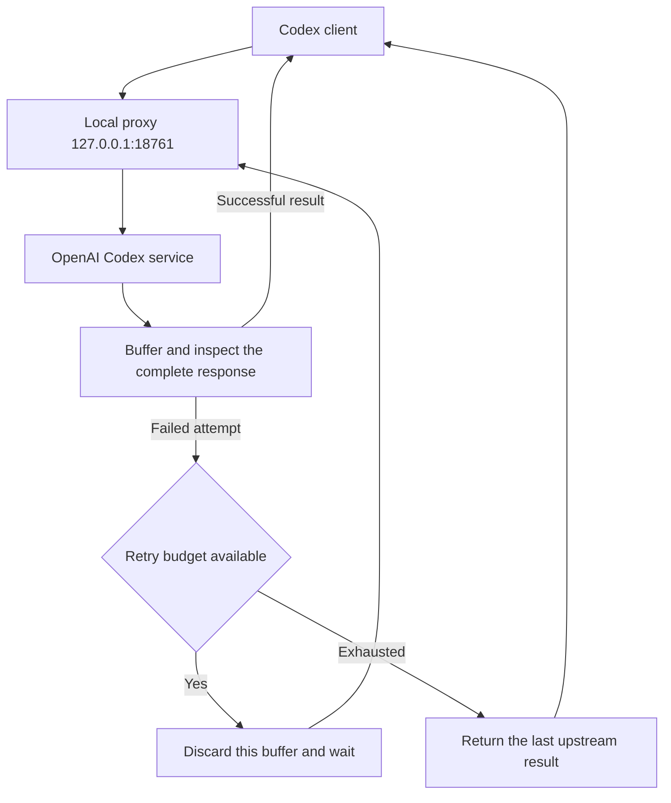

# Codex Transient Retry

**English** | [简体中文](README.zh-CN.md)

[](https://github.com/shenmuegit/codex-transient-retry/actions/workflows/ci.yml)
[](pyproject.toml)
[](docs/windows.md)
[](LICENSE)

Add local automatic retries to every request sent to the Codex gateway, including model requests, remote context compaction, images, and model catalogs. This helper runs on Windows, reuses your ChatGPT sign-in and model selection, and requires only the Python standard library at runtime.

**The proxy buffers each response in full, delaying text and tool calls.** This is an unofficial helper that depends on Codex backend interfaces.

## Contents

- [Features and scope](#features-and-scope)
- [Quick start](#quick-start)
- [Stop and roll back](#stop-and-roll-back)
- [How it works](#how-it-works)
- [Retry policy and supported routes](#retry-policy-and-supported-routes)
- [Configuration and runtime data](#configuration-and-runtime-data)
- [Troubleshooting](#troubleshooting)
- [Development and tests](#development-and-tests)
- [Documentation](#documentation)
- [License](#license)

## Features and scope

This helper is intended for personal use on one machine:

- Retry HTTP errors, explicit JSON/SSE failures, and connection interruptions for every forwarded path and HTTP method
- Buffer each response and discard failed attempts before delivering partial output or local tool calls
- Start at Windows sign-in through a scheduled task, with configuration backups and rollback support
- Forward images and new backend routes through the same retry loop, without a route whitelist

Persistent failures can still exhaust the retry budget. Error codes do not enable or prevent retries; authentication, quota, and invalid-request errors use the same policy. Only requests sent to the configured gateway are covered; desktop login, updates, and third-party plugins using separate connections are not automatically rerouted.

## Quick start

Prepare the following environment:

- Windows with permission to create scheduled tasks
- Git and Python 3.11+, including `pythonw.exe` in the Python installation directory
- Codex signed in with ChatGPT, with both `python` and `codex` available in PowerShell
- Network access to OpenAI services, using existing environment or system proxy settings when needed

If you already installed this helper elsewhere, follow the [Windows migration guide (Chinese)](docs/windows.md).

### 1. Get the source and check commands

Clone the repository into a directory you intend to keep, then check Python and Codex:

```powershell
git clone https://github.com/shenmuegit/codex-transient-retry.git
Set-Location codex-transient-retry
python --version
codex --version
```

The scheduled task references source files in this directory. Keep the directory in place while the helper is installed. Running the proxy does not require `pip install`.

### 2. Enable the proxy

Finish active model tasks and exit Codex completely, then run this command from the project directory:

```powershell
powershell.exe -NoProfile -ExecutionPolicy RemoteSigned -File .\Enable.ps1
```

The script creates the `CodexTransientRetry` sign-in task and checks the proxy before backing up and updating Codex configuration. The built-in `openai` provider, ChatGPT sign-in, and model selection are preserved. Only `openai_base_url` points at the local gateway, retaining Dot compatibility. Native client retries remain enabled and can multiply proxy attempts. The execution policy applies only to this PowerShell process; it does not change the persistent system policy.

### 3. Check status and reopen Codex

Check the health endpoint and scheduled task:

```powershell
Invoke-RestMethod 'http://127.0.0.1:18761/health'
Get-ScheduledTask -TaskName 'CodexTransientRetry'
```

The health response should include `service: codex-transient-retry` and `version: 12`. This `version` is the service revision; the Python project version is `0.6.0`. Reopen Codex after these checks so new connections use the local proxy.

## Stop and roll back

Finish model tasks and exit Codex, then run the disable script from the original installation directory:

```powershell
powershell.exe -NoProfile -ExecutionPolicy RemoteSigned -File .\Disable.ps1
```

The script removes its managed configuration blocks and scheduled task, then asks the proxy to stop. Other settings and historical backups remain. Reopen Codex afterward to load the restored connection configuration.

The script refuses to overwrite managed blocks that you edited manually. See [Windows deployment and migration (Chinese)](docs/windows.md) for upgrades, installation paths, and validation failures.

## How it works

Codex sends requests to the local proxy. Every forwarded request uses the existing authentication headers, buffers the response, and checks whether to return it or retry:



The upstream origin is fixed at `https://chatgpt.com`; the original request path and query are preserved. Outbound connections can use environment or system proxy settings. This helper does not configure proxy software or select network nodes.

Buffering applies to one HTTP request at a time. Partial text and local tool calls from failed attempts are not delivered early. Buffering cannot undo server-side operations or guarantee that the backend executes a request only once. See the [architecture guide (Chinese)](docs/architecture.md) for protocol parsing and connection upgrade details.

## Retry policy and supported routes

Every forwarded request uses the same retry policy. There are no route, method, authentication, origin, or error-code allowlists or denylists.

| Setting | Behavior |
| --- | --- |
| Attempts per incoming proxy request | At most 4: the initial request plus 3 retries |
| Retry delays | 30, 60, and 120 seconds; a valid `Retry-After` can extend the wait |
| Failed attempts | All HTTP statuses of 400 or greater, explicit JSON/SSE errors, and connection or response interruptions |
| Exhausted retries | Return the last upstream status, headers, and body; connection failures without a response return HTTP 502 |
| Model catalogs | Fetch on every request, without a cache or special timeout |
| Redirects | Return the original status and `Location` to the client |
| WebSocket or other HTTP upgrades | Retry failed handshakes, then relay bytes in both directions after HTTP 101 |
| `GET /health` | Return the service revision, process information, and retry parameters |

This is a per-request proxy budget, not an end-to-end client limit: Codex can retry after the proxy exhausts an attempt sequence. Built-in provider IDs cannot be redefined to disable those native retries. Dot cloud conversations use their own connections and are not routed through this local gateway.

The proxy adds no request or response size cap, I/O timeout, retry scheduling deadline, concurrency quota, or memory quota. It listens on loopback and forwards to the configured ChatGPT origin. Upstream authentication, quotas, and client timeouts still apply.

Business payloads remain unchanged, including gzip-compressed response bytes and the caller's `Accept-Encoding`. HTTP framing is read to retain requests for retries: chunked uploads are decoded and replayed with a content length, and trailer fields become request headers. Connection-scoped headers are handled per hop; this is not an access policy. The helper is not a byte-for-byte TCP tunnel for ordinary HTTP.

HTTP responses are buffered before delivery, so failed attempts cannot release partial local tool calls. Once an upgraded connection starts relaying bytes, it cannot transparently replay an interrupted session. Native WebSocket message failures are passed to the client without buffering or message-level retries.

Image requests and other writes retain caller-provided idempotency keys. Retrying an operation that already completed upstream can repeat the operation or charge. Unbounded buffering can consume substantial memory, and a silent peer can keep a request waiting until the client cancels or the connection closes. Revalidate native Codex compatibility after upgrading.

## Configuration and runtime data

Codex configuration remains at `%USERPROFILE%\.codex\config.toml`, or under `CODEX_HOME`. Logs, rollback state, and backups default to `local-diagnostics/transient-retry/` beside `retry_proxy.py`; set `CODEX_RETRY_RUNTIME_DIR` to choose another runtime directory. The runtime paths below are relative to that directory:

| Path | Purpose |
| --- | --- |
| `config.toml.retry-backup-*.bak` | Original configuration backups |
| `config.toml.retry-upgrade-*.bak` | Pre-upgrade configuration backups |
| `config-state.json` | Configuration rollback state |
| `proxy.log` | Proxy metadata logs, retaining up to 3 files of approximately 2 MiB each |

Upgrades read legacy rollback state from the Codex configuration directory and copy the original backup into the runtime directory. Legacy files remain untouched.

Logs do not record credentials, prompts, or response bodies. Configuration backups may contain sensitive settings and should stay on your machine. The repository excludes sign-in state, personal configuration, backups, runtime logs, and network proxy rules.

## Troubleshooting

Check the health endpoint first, then inspect the task, logs, or configuration for the relevant symptom:

| Symptom | What to check |
| --- | --- |
| Health connection fails | Scheduled task status, port 18761, and `proxy.log` |
| A task from another installation already exists | Disable the old installation from its own directory, then follow the migration steps |
| No text appears immediately after a request | The proxy buffers a complete response; check logs to distinguish normal waiting from retries |
| An upstream error returns after retries | Inspect `exhausted` in the metadata log and the original upstream error/request ID |
| The proxy starts but cannot reach the upstream | Check the proxy process's environment/system proxy settings and allow direct access to loopback addresses |

See [Windows troubleshooting (Chinese)](docs/windows.md) for further steps. Report problems through [GitHub Issues](https://github.com/shenmuegit/codex-transient-retry/issues) with versions and redacted errors. Keep sign-in files and configuration backups on your machine.

## Development and tests

Create a virtual environment in the project directory, install development dependencies, then run checks, tests, and builds:

```powershell
python -m venv .venv
.\.venv\Scripts\python.exe -m pip install -e '.[dev]'
.\.venv\Scripts\ruff.exe check .
.\.venv\Scripts\ruff.exe format --check .
.\.venv\Scripts\python.exe -B -m unittest discover -s tests -v
.\.venv\Scripts\python.exe -m build
```

Tests use local mock services and temporary configuration without OpenAI credentials. Windows script tests mock scheduled-task and network operations. CI covers Windows Python 3.11/3.13, Ubuntu Python 3.11, formatting, package builds, and the installed command.

The Python package provides the `codex-transient-retry` command. After installation, run `codex-transient-retry --serve` manually. Windows automatic startup still uses the PowerShell scripts in the source directory. See the [Windows deployment guide (Chinese)](docs/windows.md) for manual setup.

## Documentation

The detailed guides under `docs/` are currently in Simplified Chinese:

| Document | Contents |
| --- | --- |
| [Architecture](docs/architecture.md) | Response buffering, error classification, retry budgets, and security scope |
| [Windows deployment and migration](docs/windows.md) | First setup, directory migration, manual operation, rollback, and troubleshooting |
| [Validation and compatibility](docs/validation.md) | Tested versions, verification methods, and unverified behavior |
| [Changelog](CHANGELOG.md) | Project version history, in English |

## License

This project is available under the [MIT license](LICENSE).
