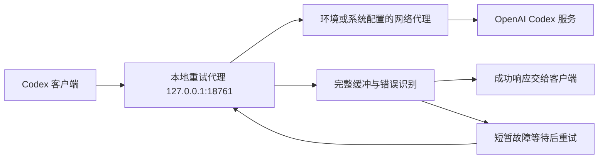

# Codex Transient Retry

[](https://github.com/shenmuegit/codex-transient-retry/actions/workflows/ci.yml)

为 Codex 的模型请求和远程上下文压缩增加本地故障重试。复用现有 ChatGPT 登录，保留原模型选择，通过完整缓冲一次模型响应，避免将失败尝试中的部分工具调用提前交给客户端。

项目版本为 `0.5.0`，服务修订号为 5。运行时仅使用 Python 标准库；Windows 启停脚本负责计划任务和配置回滚。本项目是非官方本机辅助工具，依赖 Codex 后端接口及客户端的 HTTP 回退行为。

## 原理



代理接收 Codex 携带的鉴权信息，转发到固定的 `https://chatgpt.com/backend-api/codex`。它会检查 HTTP 状态、JSON 错误和 SSE 事件；对可识别的容量不足、临时服务端错误和响应中断最多重试 3 次，依次等待 30、60、120 秒。不可重试错误直接返回，重试耗尽后返回明确的本地上限错误。

缓冲单位是**一次模型请求**，并非整段会话。文字、推理和工具调用会在该次成功响应完整接收后显示。重试过程中丢弃失败尝试的缓冲内容，避免在本机执行其中的部分工具调用；服务端已经执行的操作无法回滚。

## 支持范围

| 请求 | 处理方式 |
|---|---|
| `POST /backend-api/codex/responses` | 缓冲响应，识别短暂故障并重试 |
| `POST /backend-api/codex/responses/compact` | 远程上下文压缩请求重试 |
| `GET /backend-api/codex/models` | 单次转发，有效的模型列表按凭据和账户头隔离缓存 5 分钟，连接及读取空闲超时 3 秒 |
| `GET /health` | 查看进程、代理协议版本和重试参数 |

身份验证失败、额度不足、上下文超限和无效请求等错误不会由本代理重试。完整规则及限制见 [实现原理](docs/architecture.md)。

## Windows 启用

需要 Python 3.11+（含 `pythonw.exe`）、已登录 ChatGPT 的 Codex，以及可用的 Windows 计划任务。`python` 和 `codex` 应在 PATH 中。

在项目目录运行：

```powershell
python --version
codex --version
powershell.exe -NoProfile -ExecutionPolicy RemoteSigned -File .\Enable.ps1
Invoke-RestMethod 'http://127.0.0.1:18761/health'
```

启用脚本创建当前用户登录时运行的 `CodexTransientRetry` 任务，备份 Codex 配置，并将内置 OpenAI 地址指向本地代理。缺失配置文件时会创建空配置作为起点。默认 provider 保持为内置 `openai`；附加 provider 用于兼容保存了旧选择的聊天。启用后完全退出并重新打开 Codex，加载新的连接配置。

示例中的执行策略仅作用于该 PowerShell 进程，不修改持久策略。如果本机已经从另一个目录部署本程序，先阅读 [部署与迁移](docs/windows.md)；脚本会检查计划任务归属，拒绝跨安装覆盖或卸载。

## 关闭与回滚

先结束正在进行的任务并退出 Codex，再运行：

```powershell
powershell.exe -NoProfile -ExecutionPolicy RemoteSigned -File .\Disable.ps1
```

回滚只移除本程序管理的配置块，保留其他设置；手动修改过管理块时会拒绝覆盖。原始备份继续保留在 Codex 配置文件旁。详情见 [部署与迁移](docs/windows.md)。

## 开发与测试

```powershell
python -m venv .venv
.\.venv\Scripts\python.exe -m pip install -e '.[dev]'
.\.venv\Scripts\ruff.exe check .
.\.venv\Scripts\ruff.exe format --check .
.\.venv\Scripts\python.exe -B -m unittest discover -s tests -v
.\.venv\Scripts\python.exe -m build
```

测试使用本机模拟服务及临时配置，不需要 OpenAI 凭据。Windows 安装测试只在临时目录调用配置管理，并模拟计划任务和网络操作。CI 检查 Windows 的 Python 3.11／3.13、Ubuntu 的 Python 3.11，以及格式、打包和安装后的命令入口。兼容性及验收边界见 [验证记录](docs/validation.md)。

`pyproject.toml` 提供标准 Python 包元数据和 `codex-transient-retry` 命令入口。安装 Python 包后可手动运行 `codex-transient-retry --serve`；Windows 自动启停请保留源码目录，并使用该目录中的 PowerShell 脚本。

## 项目结构

```text
retry_proxy.py               代理、错误识别、重试及配置管理
Enable.ps1 / Disable.ps1     Windows 计划任务与启停
pyproject.toml              Python 包元数据和命令入口
tests/                      本地回归测试与隔离的 Windows 脚本探针
docs/architecture.md        协议、缓冲、安全范围及已知限制
docs/windows.md             部署、迁移、回滚与排查
docs/validation.md          已验证版本与验证边界
```

## 运行数据与边界

默认配置目录为 `%USERPROFILE%\.codex`，也可通过 `CODEX_HOME` 指定。运行日志和配置状态保存在其 `transient-retry` 子目录；日志最多保留 3 个约 2 MiB 的文件。日志不记录凭据、提示词或回复正文；配置备份可能包含用户自己的敏感设置，应保留在本机。

本项目只监听本机回环地址，单次请求及响应限制为 64 MiB，使用固定上游并拒绝跟随重定向。它依赖 Codex 当前使用的后端协议及 HTTP 回退行为，升级客户端后需要重新验证。持续故障仍可能耗尽重试；3 秒和 300 秒均为连接／读取空闲超时，900 秒是重试调度预算，均不构成严格的整次请求墙钟上限。

支持范围限于上表列出的路由；调用其他后端路由的客户端功能需要另行兼容。仓库不包含登录状态、用户配置、配置备份、运行日志或代理规则文件。使用许可见 [MIT License](LICENSE)。
