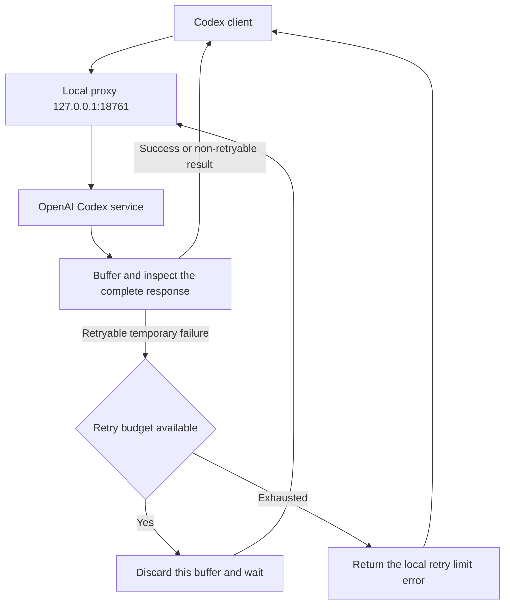

# Codex Transient Retry

**English** | [简体中文](README.zh-CN.md)

[](https://github.com/shenmuegit/codex-transient-retry/actions/workflows/ci.yml)
[](pyproject.toml)
[](docs/windows.md)
[](LICENSE)

Add local automatic retries to every request sent to the Codex gateway, including model requests, remote context compaction, images, and model catalogs. This helper runs on Windows, reuses your ChatGPT sign-in and model selection, and requires only the Python standard library at runtime.

**The proxy buffers each response in full, delaying text and tool calls.** This is an unofficial helper that depends on Codex backend interfaces and the client's HTTP fallback behavior.

## Contents

- [Features and scope](#features-and-scope)
- [Quick start](#quick-start)
- [Stop and roll back](#stop-and-roll-back)
- [How it works](#how-it-works)
- [Retry policy and supported routes](#retry-policy-and-supported-routes)
- [Configuration and runtime data](#configuration-and-runtime-data)
- [Troubleshooting](#troubleshooting)
- [Development and tests](#development-and-tests)
- [Documentation](#documentation)
- [License](#license)

## Features and scope

This helper is intended for personal use on one machine:

- Retry recognized temporary failures for every forwarded path and HTTP method
- Buffer each response and discard failed attempts before delivering partial output or local tool calls
- Start at Windows sign-in through a scheduled task, with configuration backups and rollback support
- Forward images and new backend routes through the same retry loop, without a route whitelist

Persistent failures can still exhaust the retry budget. Explicit authentication, quota, context-length, and invalid-request errors return immediately. Only requests sent to the configured gateway are covered; desktop login, updates, and third-party plugins using separate connections are not automatically rerouted.

## Quick start

Prepare the following environment:

- Windows with permission to create scheduled tasks
- Git and Python 3.11+, including `pythonw.exe` in the Python installation directory
- Codex signed in with ChatGPT, with both `python` and `codex` available in PowerShell
- Network access to OpenAI services, using existing environment or system proxy settings when needed

If you already installed this helper elsewhere, follow the [Windows migration guide (Chinese)](docs/windows.md).

### 1. Get the source and check commands

Clone the repository into a directory you intend to keep, then check Python and Codex:

```powershell
git clone https://github.com/shenmuegit/codex-transient-retry.git
Set-Location codex-transient-retry
python --version
codex --version
```

The scheduled task references source files in this directory. Keep the directory in place while the helper is installed. Running the proxy does not require `pip install`.

### 2. Enable the proxy

Finish active model tasks and exit Codex completely, then run this command from the project directory:

```powershell
powershell.exe -NoProfile -ExecutionPolicy RemoteSigned -File .\Enable.ps1
```

The script creates the `CodexTransientRetry` sign-in task and checks the proxy before backing up and updating Codex configuration. The default model provider stays `openai`, with its connection address pointing to the local proxy. The execution policy applies only to this PowerShell process; it does not change the persistent system policy.

### 3. Check status and reopen Codex

Check the health endpoint and scheduled task:

```powershell
Invoke-RestMethod 'http://127.0.0.1:18761/health'
Get-ScheduledTask -TaskName 'CodexTransientRetry'
```

The health response should include `service: codex-transient-retry` and `version: 8`. This `version` is the service revision; the Python project version is `0.6.0`. Reopen Codex after these checks so new connections use the local proxy.

## Stop and roll back

Finish model tasks and exit Codex, then run the disable script from the original installation directory:

```powershell
powershell.exe -NoProfile -ExecutionPolicy RemoteSigned -File .\Disable.ps1
```

The script removes its managed configuration blocks and scheduled task, then asks the proxy to stop. Other settings and historical backups remain. Reopen Codex afterward to load the restored connection configuration.

The script refuses to overwrite managed blocks that you edited manually. See [Windows deployment and migration (Chinese)](docs/windows.md) for upgrades, installation paths, and validation failures.

## How it works

Codex sends requests to the local proxy. Every forwarded request uses the existing authentication headers, buffers the response, and checks whether to return it or retry:



The upstream origin is fixed at `https://chatgpt.com`; the original request path and query are preserved. Outbound connections can use environment or system proxy settings. This helper does not configure proxy software or select network nodes.

Buffering applies to one model request at a time. Partial text and local tool calls from failed attempts are not delivered early. Buffering cannot undo server-side operations or guarantee that the backend executes a request only once. See the [architecture guide (Chinese)](docs/architecture.md) for protocol parsing and HTTP fallback details.

## Retry policy and supported routes

Every forwarded request uses these defaults. A valid `Retry-After` can extend the wait:

HTTP 507 also qualifies when the response body contains `exceeded request buffer limit while retrying upstream` (case-insensitive). Explicit non-retryable error codes still take precedence; status 507 alone does not trigger a retry.

| Setting | Behavior |
| --- | --- |
| Attempts | At most 4: the initial request plus 3 retries |
| Retry delays | 30, 60, and 120 seconds |
| Retryable failures | Recognized capacity errors, server overload, temporary service errors, and connection or response interruptions |
| Explicit non-retryable errors | Authentication failure, insufficient quota, context overflow, missing models, invalid requests, and similar errors |
| Exhausted budget | Return `local_retry_limit_exceeded` with the attempt count and last reason |

There is no route or HTTP method whitelist. Unknown paths reach the upstream, and upstream errors return according to the same policy. A few requests retain protocol-specific handling:

| Request | Behavior |
| --- | --- |
| `POST /backend-api/codex/responses` | Buffer model responses and retry temporary failures |
| `POST /backend-api/codex/responses/compact` | Buffer remote compaction responses and retry temporary failures |
| Images and all other authenticated HTTP methods and paths | Buffer and retry recognized temporary failures |
| `GET /backend-api/codex/models` | Retry temporary failures; cache a valid catalog for 5 minutes per matching credential and account, with a 3-second connection/read idle timeout per attempt |
| `GET /health` | Return the service revision, process information, and retry parameters |

Inference connection/read idle timeouts are at most 300 seconds, and the retry scheduling budget is 900 seconds. A slowly but continuously transmitting response can exceed these values. **The 900-second budget is not a hard limit on total request duration.**

Image requests and other writes keep their original payload and headers, including any caller-provided idempotency key. They use the same retry policy, including the matching 507 rule. If the upstream completed an operation before its response was lost, retrying can repeat the operation or charge. GET catalog failures also wait through the retry delays, so startup can take longer during an outage.

The proxy listens only on loopback, limits each request and response to 64 MiB, and refuses upstream redirects. It does not forward WebSocket connections or impose global concurrency or memory quotas. Revalidate compatibility after upgrading Codex.

## Configuration and runtime data

The configuration directory defaults to `%USERPROFILE%\.codex`. Set `CODEX_HOME` to use another directory. Runtime data lives under that directory:

| Path | Purpose |
| --- | --- |
| `config.toml` | Codex settings and the helper's managed configuration blocks |
| `config.toml.retry-backup-*.bak` | Original configuration backups |
| `config.toml.retry-upgrade-*.bak` | Pre-upgrade configuration backups |
| `transient-retry/config-state.json` | Configuration rollback state |
| `transient-retry/proxy.log` | Proxy metadata logs, retaining up to 3 files of approximately 2 MiB each |

Logs do not record credentials, prompts, or response bodies. Configuration backups may contain sensitive settings and should stay on your machine. The repository excludes sign-in state, personal configuration, backups, runtime logs, and network proxy rules.

## Troubleshooting

Check the health endpoint first, then inspect the task, logs, or configuration for the relevant symptom:

| Symptom | What to check |
| --- | --- |
| Health connection fails | Scheduled task status, port 18761, and `proxy.log` |
| A task from another installation already exists | Disable the old installation from its own directory, then follow the migration steps |
| No text appears immediately after a request | The proxy buffers a complete response; check logs to distinguish normal waiting from retries |
| `local_retry_limit_exceeded` | The current budget is exhausted; inspect the attempt count and last reason, then retry after the upstream or network recovers |
| The proxy starts but cannot reach the upstream | Check the proxy process's environment/system proxy settings and allow direct access to loopback addresses |

See [Windows troubleshooting (Chinese)](docs/windows.md) for further steps. Report problems through [GitHub Issues](https://github.com/shenmuegit/codex-transient-retry/issues) with versions and redacted errors. Keep sign-in files and configuration backups on your machine.

## Development and tests

Create a virtual environment in the project directory, install development dependencies, then run checks, tests, and builds:

```powershell
python -m venv .venv
.\.venv\Scripts\python.exe -m pip install -e '.[dev]'
.\.venv\Scripts\ruff.exe check .
.\.venv\Scripts\ruff.exe format --check .
.\.venv\Scripts\python.exe -B -m unittest discover -s tests -v
.\.venv\Scripts\python.exe -m build
```

Tests use local mock services and temporary configuration without OpenAI credentials. Windows script tests mock scheduled-task and network operations. CI covers Windows Python 3.11/3.13, Ubuntu Python 3.11, formatting, package builds, and the installed command.

The Python package provides the `codex-transient-retry` command. After installation, run `codex-transient-retry --serve` manually. Windows automatic startup still uses the PowerShell scripts in the source directory. See the [Windows deployment guide (Chinese)](docs/windows.md) for manual setup.

## Documentation

The detailed guides under `docs/` are currently in Simplified Chinese:

| Document | Contents |
| --- | --- |
| [Architecture](docs/architecture.md) | Response buffering, error classification, retry budgets, and security scope |
| [Windows deployment and migration](docs/windows.md) | First setup, directory migration, manual operation, rollback, and troubleshooting |
| [Validation and compatibility](docs/validation.md) | Tested versions, verification methods, and unverified behavior |
| [Changelog](CHANGELOG.md) | Project version history, in English |

## License

This project is available under the [MIT license](LICENSE).
