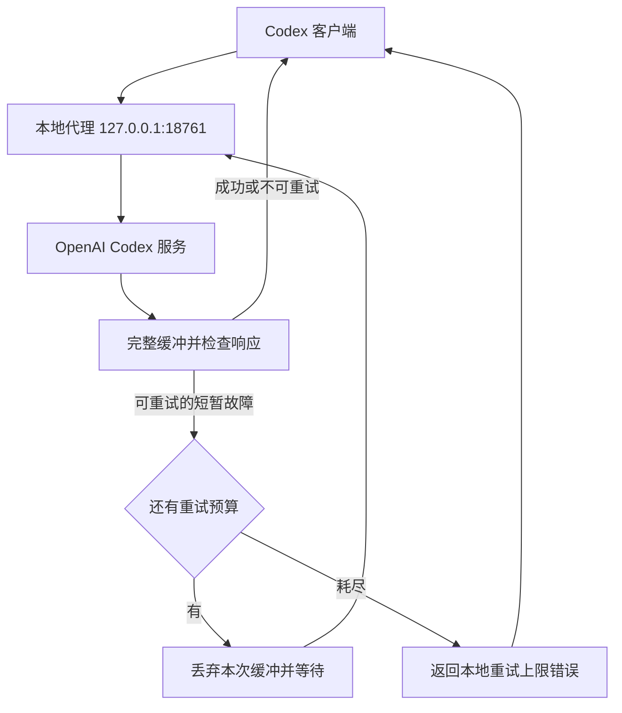

# Codex Transient Retry

[English](README.md) | **简体中文**

[](https://github.com/shenmuegit/codex-transient-retry/actions/workflows/ci.yml)
[](pyproject.toml)
[](docs/windows.md)
[](LICENSE)

为 Codex 的模型请求和远程上下文压缩增加本地自动重试，缓解容量不足、临时服务端错误和响应中断。适用于使用 ChatGPT 登录的 Windows Codex 客户端，复用现有登录状态与模型选择，运行时仅依赖 Python 标准库。

**每次模型响应完整接收后才交给客户端，文字和工具调用会延后显示。** 本项目是非官方辅助工具，依赖 Codex 后端接口及客户端的 HTTP 回退行为。

## 目录

- [功能与适用范围](#功能与适用范围)
- [快速开始](#快速开始)
- [停止并回滚](#停止并回滚)
- [工作方式](#工作方式)
- [重试策略与支持路由](#重试策略与支持路由)
- [配置与运行数据](#配置与运行数据)
- [排查问题](#排查问题)
- [开发与测试](#开发与测试)
- [相关文档](#相关文档)
- [许可证](#许可证)

## 功能与适用范围

本工具面向个人本机使用，主要处理以下情况：

- 对可识别的模型容量不足、服务过载和断流自动重试，覆盖模型回复与远程上下文压缩
- 完整缓冲单次响应，丢弃失败尝试中的部分输出，避免提前执行其中的本机工具调用
- 使用 Windows 计划任务在登录时启动，备份配置并支持关闭与回滚

持续故障仍可能耗尽重试。身份验证失败、额度不足、上下文超限和无效请求等明确错误直接返回；其他后端路由及登录方式不在当前验收范围内。

## 快速开始

启用前准备以下环境：

- Windows，且当前账户可以创建计划任务
- Git 和 Python 3.11+，Python 安装目录包含 `pythonw.exe`
- 已使用 ChatGPT 登录的 Codex，`python` 和 `codex` 均可从 PowerShell 调用
- 可访问 OpenAI 服务的网络；需要出站代理时，使用现有环境或系统代理设置

如果已经从其他目录部署本工具，先按 [Windows 部署与迁移](docs/windows.md#从旧目录迁移) 操作。

### 1. 获取源码并检查命令

将仓库克隆到准备长期保留的目录，然后确认 Python 和 Codex 命令可用：

```powershell
git clone https://github.com/shenmuegit/codex-transient-retry.git
Set-Location codex-transient-retry
python --version
codex --version
```

计划任务直接引用该目录中的源文件。安装期间及启用后不要移动或删除目录；运行代理无需执行 `pip install`。

### 2. 启用代理

先结束正在进行的模型任务并完全退出 Codex，再在项目目录执行：

```powershell
powershell.exe -NoProfile -ExecutionPolicy RemoteSigned -File .\Enable.ps1
```

脚本创建 `CodexTransientRetry` 登录任务，确认代理启动后备份并修改 Codex 配置。默认模型提供方保持为内置 `openai`，连接地址改为本地代理。执行策略只作用于当前 PowerShell 进程，不修改系统持久策略。

### 3. 确认状态并重新打开 Codex

检查健康端点和计划任务：

```powershell
Invoke-RestMethod 'http://127.0.0.1:18761/health'
Get-ScheduledTask -TaskName 'CodexTransientRetry'
```

健康检查应返回 `service: codex-transient-retry` 和 `version: 6`。这里的 `version` 是服务修订号，项目发行版本为 `0.5.1`。确认后重新打开 Codex，使新连接使用本地代理。

## 停止并回滚

先结束模型任务并退出 Codex，再从原安装目录运行关闭脚本：

```powershell
powershell.exe -NoProfile -ExecutionPolicy RemoteSigned -File .\Disable.ps1
```

脚本移除本工具管理的配置块及计划任务，并请求代理退出；其他配置和历史备份保留。随后重新打开 Codex，加载恢复后的连接配置。

如果管理块经过手动编辑，脚本会拒绝覆盖。跨目录安装、升级及校验失败的处理方式见 [Windows 部署与迁移](docs/windows.md)。

## 工作方式

Codex 将单次模型请求发送到本地代理。代理转发原有鉴权头，完整接收响应并检查结果，再决定返回或重试：



上游固定为 `https://chatgpt.com/backend-api/codex`。出站连接可使用环境或系统配置的网络代理；本工具不配置代理软件或选择节点。

缓冲单位是一次模型请求。失败尝试的部分文字与本机工具调用不会提前下发；服务端已执行的操作无法回滚，后端请求也可能执行多次。协议解析及 HTTP 回退细节见 [实现原理](docs/architecture.md)。

## 重试策略与支持路由

模型与压缩请求使用以下默认策略，有效的 `Retry-After` 可以延长等待：

HTTP 507 的响应正文命中 `exceeded request buffer limit while retrying upstream`（忽略大小写）时也可重试。明确不可重试的错误码仍优先处理，不会仅凭 507 状态码触发重试。

| 项目 | 行为 |
| --- | --- |
| 尝试次数 | 最多 4 次，即首次请求加 3 次重试 |
| 重试等待 | 依次等待 30、60、120 秒 |
| 可重试故障 | 可识别的容量不足、服务过载、临时服务错误、连接或响应中断 |
| 明确不可重试的错误 | 身份验证失败、额度不足、上下文超限、模型不存在、无效请求等 |
| 重试耗尽 | 返回 `local_retry_limit_exceeded`，包含尝试次数和最后原因 |

当前支持以下路由，模型列表请求单独使用较短的超时：

| 请求 | 处理方式 |
| --- | --- |
| `POST /backend-api/codex/responses` | 缓冲模型响应并重试短暂故障 |
| `POST /backend-api/codex/responses/compact` | 缓冲远程上下文压缩响应并重试短暂故障 |
| `GET /backend-api/codex/models` | 单次转发；有效列表按凭据及账户隔离缓存 5 分钟，连接与读取空闲超时 3 秒 |
| `GET /health` | 返回服务修订号、进程和重试参数 |

推理请求的连接与读取空闲超时最多为 300 秒，重试调度预算为 900 秒。缓慢但持续传输的响应可能超出这些时间，**900 秒不是整次请求的硬性时长上限**。

代理只监听本机回环地址，单次请求和响应分别限制为 64 MiB，并拒绝跟随上游重定向。它不转发 WebSocket，也没有全局并发或总内存配额；Codex 升级后需要重新验证兼容性。

## 配置与运行数据

配置目录默认是 `%USERPROFILE%\.codex`，也可通过 `CODEX_HOME` 指定。运行数据保存在该目录下：

| 路径 | 用途 |
| --- | --- |
| `config.toml` | Codex 配置及本工具管理的配置块 |
| `config.toml.retry-backup-*.bak` | 原始配置备份 |
| `config.toml.retry-upgrade-*.bak` | 升级前配置备份 |
| `transient-retry/config-state.json` | 配置回滚状态 |
| `transient-retry/proxy.log` | 代理元数据日志，最多保留 3 个约 2 MiB 的文件 |

日志不记录凭据、提示词或回复正文。配置备份可能包含敏感设置，应保留在本机；仓库不包含登录状态、个人配置、备份、运行日志或代理规则文件。

## 排查问题

先检查健康端点，再根据现象查看任务、日志或配置：

| 现象 | 排查方向 |
| --- | --- |
| 健康检查连接失败 | 检查计划任务状态、18761 端口占用及 `proxy.log` |
| 提示已有其他安装的计划任务 | 从旧安装目录关闭工具，再按迁移流程启用新目录 |
| 发送请求后暂时没有文字输出 | 单次响应会完整缓冲；查看日志区分正常等待与故障重试 |
| 返回 `local_retry_limit_exceeded` | 本次预算已耗尽，查看尝试次数与最后原因，确认上游或网络恢复后再试 |
| 代理启动但无法访问上游 | 检查代理进程使用的环境／系统代理设置，并确保回环地址可直接访问 |

更多操作见 [Windows 排查说明](docs/windows.md#常见排查)。反馈问题可提交 [GitHub Issue](https://github.com/shenmuegit/codex-transient-retry/issues)，附上版本和脱敏错误信息，保留登录文件与配置备份在本机。

## 开发与测试

在项目目录创建虚拟环境，安装开发依赖后执行检查、测试和构建：

```powershell
python -m venv .venv
.\.venv\Scripts\python.exe -m pip install -e '.[dev]'
.\.venv\Scripts\ruff.exe check .
.\.venv\Scripts\ruff.exe format --check .
.\.venv\Scripts\python.exe -B -m unittest discover -s tests -v
.\.venv\Scripts\python.exe -m build
```

测试使用本机模拟服务和临时配置，无需 OpenAI 凭据。Windows 脚本测试模拟计划任务及网络操作；CI 覆盖 Windows Python 3.11／3.13、Ubuntu Python 3.11，以及格式、构建和安装后的命令入口。

Python 包提供 `codex-transient-retry` 命令。安装后可用 `codex-transient-retry --serve` 手动运行；Windows 自动启停仍使用源码目录中的 PowerShell 脚本，手动部署步骤见 [Windows 部署文档](docs/windows.md#手动运行及配置)。

## 相关文档

根据需要查看以下文档：

| 文档 | 内容 |
| --- | --- |
| [实现原理](docs/architecture.md) | 响应缓冲、错误识别、重试预算及安全范围 |
| [Windows 部署与迁移](docs/windows.md) | 首次部署、旧目录迁移、手动运行、回滚和排查 |
| [验证与兼容性基线](docs/validation.md) | 已验证版本、验证方式及未验证范围 |
| [更新记录](CHANGELOG.md) | 项目版本变更 |

## 许可证

本项目采用 [MIT 许可证](LICENSE)。
