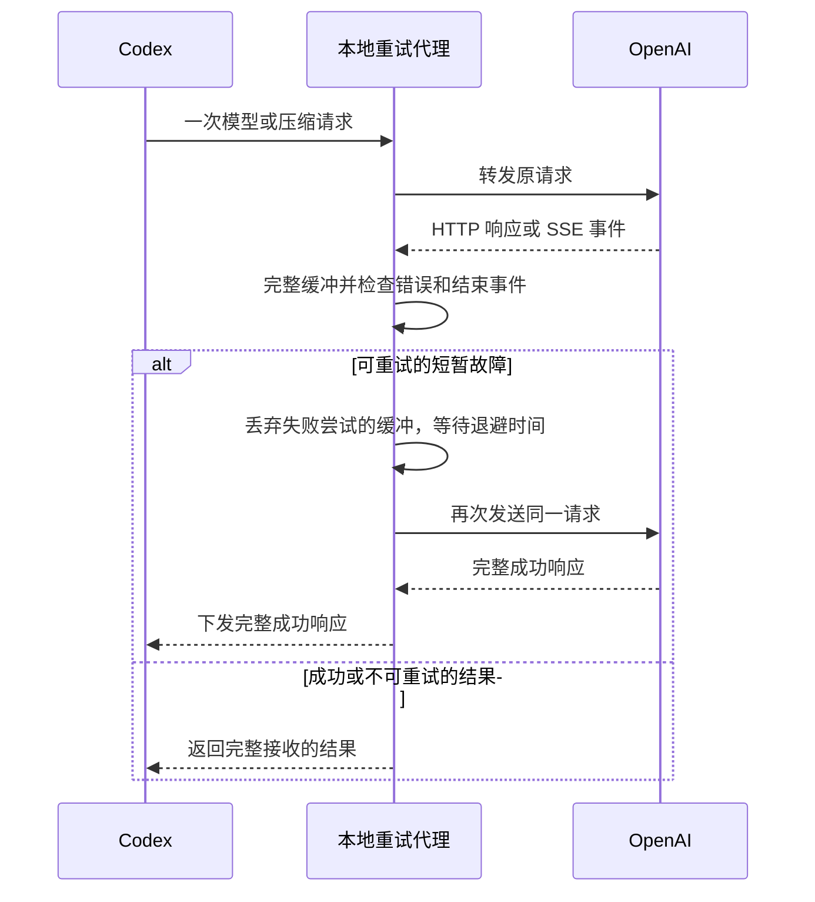

# 实现原理

## 请求路径与配置

`configure()` 在 Codex 配置中加入有明确起止标记的管理块，将 `openai_base_url` 指向 `http://127.0.0.1:18761/backend-api/codex`。默认 provider 保持为内置 `openai`，并保留用于旧聊天兼容的 `openai_transient_retry` 定义。

Codex 继续负责登录和生成鉴权头。代理自身不读取登录文件，也不创建 API key；它在内存中转发请求头和正文。上游固定为 `https://chatgpt.com/backend-api/codex`，出站网络代理由 Python urllib 的环境／系统代理配置决定。网络代理节点由用户现有的代理软件管理。

`Handler` 只接受指定的模型列表、推理、压缩和本机控制路由，拒绝带网页 `Origin` 的模型请求、缺失 Bearer 头的请求、绝对 URL 形式的请求目标、分块上传及超限正文。

## 响应缓冲与工具调用

`fetch()` 完整读取并按需解压 gzip 响应；`retry_reason()` 解析 HTTP 状态、JSON 错误或 SSE 事件。即使上游缺少 `Content-Type`，只要正文呈现 SSE 前缀，也会按 SSE 解析。解析支持初始 UTF-8 BOM 和 CR、LF、CRLF 分隔；损坏的 UTF-8、gzip 或成功状态下不完整的 JSON 被视为响应中断。

SSE 解析识别 `error`、`response.failed`、`response.incomplete`、`response.completed` 和 `[DONE]`。缺少正常结束标记的流会被视为中断；明确的 `response.incomplete` 不会由本代理自动重试。不可重试结果原样返回，交由 Codex 处理。

缓存发生在一次模型请求层。可重试失败中的部分文字及工具调用不会提前下发，也不会在下一次尝试时被重复交给本机执行。缓冲不能回滚服务端已经执行的内置工具，也不能保证后端请求只执行一次。

## 重试策略

| 情况 | 本地代理行为 |
|---|---|
| SSE／JSON 中可识别的模型容量不足、服务过载、临时服务错误 | 对推理或压缩 POST 重试 |
| 429、500、502、503、504 | 没有明确的不可重试错误码时重试 |
| 507 | 正文命中 `exceeded request buffer limit while retrying upstream`（忽略大小写）且没有明确不可重试错误码时重试；不按状态码一概重试 |
| 连接错误、读取中断、SSE 缺少结束事件 | 重试 |
| 400 | 仅明确识别的可重试错误会重试，其余直接返回 |
| 401、403、404、413、422 | 直接返回 |
| 额度不足、无效凭据、模型不存在、上下文超限等明确错误码 | 直接返回 |
| 模型列表 GET | 单次转发，不进行延迟重试 |
| 客户端取消 | 在重试间隔及尝试边界停止；正在阻塞的读取仍受 I/O 超时约束 |

默认最多 4 次尝试，即首次请求加 3 次重试，等待 30、60、120 秒。有效的 `Retry-After` 秒数或 HTTP 日期可以延长等待；下一次等待超出重试调度预算时提前结束。

重试耗尽或无法继续调度时，`retry_limit_reply()` 返回 HTTP 400 和 `local_retry_limit_exceeded`，附带尝试次数、最后原因及可用的请求 ID。这样可阻止已验收版本的内置连接再把本地预算乘以原生重试次数。附加的兼容 provider 同时将原生请求／流重试设为 0。

HTTP 400 在这里是本地终止信号，不表示原始上游故障一定是请求参数错误；原始状态保存在 `upstream_status`。

## HTTP 回退

当前实现不转发 WebSocket。内置连接发送 WebSocket Upgrade 时，代理返回 HTTP 426，使已验收的 Codex 版本改用 HTTP。后续 HTTP SSE 响应仍按完整缓冲方式处理。

HTTP 426 回退及本地 HTTP 400 终止行为依赖客户端实现，不能据此保证所有未来版本兼容。

## 启动路径与超时

| 参数 | 当前值 | 含义 |
|---|---:|---|
| `MODEL_CATALOG_TIMEOUT` | 3 秒 | 模型列表连接及读取空闲超时 |
| 推理单次 `fetch()` 超时 | 最多 300 秒 | 连接及读取空闲超时，受剩余调度预算约束 |
| `DEADLINE_SECONDS` | 900 秒 | 安排后续重试的预算 |
| 模型列表缓存 | 300 秒 | 按请求路径、Bearer 凭据及 ChatGPT-Account-ID 匹配的单条有效目录缓存 |
| `MAX_BODY` | 64 MiB | 单次请求和响应大小限制 |

urllib 的 socket 超时约束连接及读取空闲时间。缓慢但持续传输的正文可能超出上述数字，因此 900 秒不是硬性的总请求时长上限。

登录初始化、Statsig、客户端插件初始化及网络节点选择由现有客户端和网络环境处理。本程序不修改 Codex 安装包。

## 状态、恢复与安全范围

配置管理会备份原文件，检查管理块内容及并发修改，再用临时文件替换配置。文件缺失时启用会创建空配置；对缺失文件执行关闭不会创建目录或文件。关闭时只移除管理块；保留用户其他配置和历史备份。

启用命令返回本次操作的备份及应用后文件摘要。客户端校验失败时，原本未变化的配置保持原状；首次启用或升级则从本次备份恢复。恢复前会核对摘要，验证期间有其他编辑时拒绝覆盖并报告错误。计划任务和配置修改不是跨进程事务，操作应由一个部署者串行执行。

请求及响应正文保留在内存，日志只记录路径、状态、错误分类及重试元数据。固定上游、HTTPS 证书验证及禁止重定向用于约束鉴权信息的发送目标；本机回环 HTTP 不提供传输加密。

当前适用于个人本机客户端。线程服务没有额外的全局并发或总内存配额，缓冲会增加首段显示延迟和内存使用。部署目录、登录状态、配置备份及诊断日志应分开管理，发布项目时不应附带用户数据。
